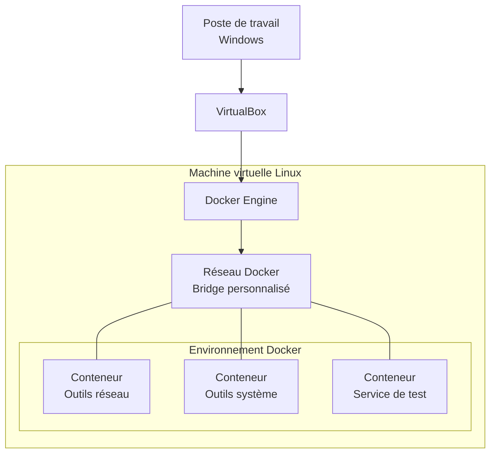

<!-- Header -->
<div align="center">


<p>
  <strong>Une boîte à outils conteneurisée pour les tests réseau et système destinés aux informaticiens orientés infrastructure.</strong>
</p>

<p>
  
  
  
  
  
  
  
  
</p>

</div>

## Présentation

**Docker Network Toolkit** est un projet pédagogique réalisé dans le cadre de la formation à l'ETML.

L'objectif est de développer une boîte à outils destinée aux informaticiens orientés infrastructure, sous la forme d'un ensemble de conteneurs Docker regroupant différents outils de diagnostic réseau et système.

L'infrastructure repose sur Docker Engine et Docker Compose, exécutés dans une machine virtuelle Linux sous VirtualBox.

Le projet permet de découvrir la virtualisation par conteneurs, la personnalisation d'images Docker, l'orchestration de plusieurs services et la communication entre conteneurs.

> **État du projet :** réalisation en cours. Les composants et fonctionnalités seront considérés comme validés uniquement après leur déploiement et leurs tests.

## Objectifs

| Étape | Objectif | Résultat attendu |
|:---:|---|---|
| 01 | Préparer l'environnement | VM Linux fonctionnelle avec Docker Engine et Compose |
| 02 | Construire une image personnalisée | Dockerfile documenté et image fonctionnelle |
| 03 | Déployer plusieurs conteneurs | Composition Docker opérationnelle |
| 04 | Configurer le réseau | Communication entre les conteneurs et accès depuis l'hôte |
| 05 | Tester les services | Tests réseau et système documentés |
| 06 | Livrer le projet | Documentation technique, schéma réseau et présentation |

## Architecture

L'environnement se compose de trois niveaux : le poste de travail, la machine virtuelle hébergeant Docker et les conteneurs.



Les conteneurs communiquent à travers un réseau virtuel Docker. Les ports nécessaires sont publiés sur la machine virtuelle afin de permettre l'accès depuis le poste de travail.

Le schéma définitif sera complété avec les interfaces, sous-réseaux, passerelles, adresses IP et ports réellement utilisés.

### Composants

| Composant | Rôle |
|---|---|
| Docker Engine | Gestion des images, conteneurs, réseaux et volumes |
| Docker Compose | Définition et orchestration des services |
| Dockerfile | Personnalisation des images |
| Réseau bridge | Communication entre les conteneurs |
| Conteneurs d'outils | Exécution des diagnostics réseau et système |
| VirtualBox | Hébergement de la machine virtuelle Linux |

## Environnement technique

### Machine virtuelle

| Paramètre | Configuration |
|---|---|
| Virtualisation | Oracle VirtualBox |
| Système | Linux (Debian ou Ubuntu) |
| Conteneurisation | Docker Engine |
| Orchestration | Docker Compose |
| Configuration | Dockerfile et YAML |
| Scripts | Bash |

Les versions définitives du système et des composants seront renseignées après l'installation.

### Technologies

| Technologie | Utilisation |
|---|---|
| Docker | Exécution des conteneurs |
| Docker Compose | Gestion de plusieurs services |
| Linux | Système hôte Docker |
| Bash | Automatisation et commandes |
| YAML | Configuration de l'infrastructure |
| Git | Gestion des versions du projet |

## Organisation du dépôt

```text
Docker-Network-Toolkit/
├── README.md
├── compose.yaml
├── .gitignore
│
├── containers/
│   ├── toolbox/
│   │   └── Dockerfile
│   └── ...
│
├── scripts/
│   └── ...
│
├── docs/
│   ├── installation/
│   ├── architecture/
│   ├── tests/
│   └── rapport-technique/
│
└── .github/
    └── workflows/
```

L'organisation sera adaptée aux conteneurs et aux scripts réellement développés pendant le projet.

## Réseau et communication

La configuration réseau doit permettre de comprendre et de vérifier les communications entre les différents éléments de l'infrastructure.

Les points étudiés sont notamment :

- La création d'un réseau Docker personnalisé.
- L'attribution des adresses IP et des passerelles.
- La communication entre les conteneurs.
- La résolution des noms de services.
- La publication des ports vers la machine hôte.
- La communication entre Windows, la VM Linux et les conteneurs.

Les adresses IP et les informations réseau seront relevées directement sur l'infrastructure déployée.

## Sécurité et bonnes pratiques

Le projet applique les principes suivants :

1. Utiliser des images de base adaptées et fixer leurs versions.
2. Limiter les paquets installés aux besoins des outils.
3. Éviter l'exécution en root lorsque cela est possible.
4. Ne pas placer de mots de passe ou de secrets dans les Dockerfiles ou fichiers Compose.
5. Utiliser des volumes pour les données qui doivent persister.
6. Documenter les privilèges particuliers nécessaires à certains outils réseau.
7. Versionner les fichiers de configuration avec Git.

## Limites du laboratoire

Ce projet est conçu dans un contexte pédagogique. Il sert à expérimenter et comprendre Docker, les réseaux virtuels et l'administration système.

Il ne constitue pas une infrastructure de production.

| Élément | Périmètre |
|---|---|
| Environnement | Une machine virtuelle Linux |
| Orchestration | Docker Compose |
| Réseau | Réseaux Docker locaux |
| Utilisation | Tests réseau et système |
| Infrastructure distribuée | Hors périmètre |
| Haute disponibilité | Hors périmètre |

## Documentation technique

Les ressources suivantes servent de références pour la réalisation du projet.

| Technologie | Documentation |
|---|---|
| Docker | [Documentation officielle](https://docs.docker.com/) |
| Docker Engine | [Docker Engine](https://docs.docker.com/engine/) |
| Docker Compose | [Documentation Compose](https://docs.docker.com/compose/) |
| Dockerfile | [Référence Dockerfile](https://docs.docker.com/reference/dockerfile/) |
| Réseaux Docker | [Networking](https://docs.docker.com/engine/network/) |
| Volumes Docker | [Storage](https://docs.docker.com/engine/storage/) |
| Debian | [Documentation Debian](https://www.debian.org/doc/) |
| VirtualBox | [Manuel utilisateur](https://www.virtualbox.org/manual/) |

---

<!-- Footer -->
<div align="center">


<h3>Docker Network Toolkit</h3>

<p>
  <strong>Diagnostiquer. Analyser. Comprendre.</strong>
</p>

<p>
  Projet pédagogique individuel · ETML · 2026
</p>

<p>
  <a href="https://github.com/RufusTheDwarf/Docker-Network-Toolkit">GitHub</a>
  &nbsp;·&nbsp;
  <a href="https://github.com/RufusTheDwarf/Docker-Network-Toolkit/issues">Issues</a>
</p>

<sub>Développé dans le cadre d'un projet de formation en infrastructure informatique.</sub>

</div>
