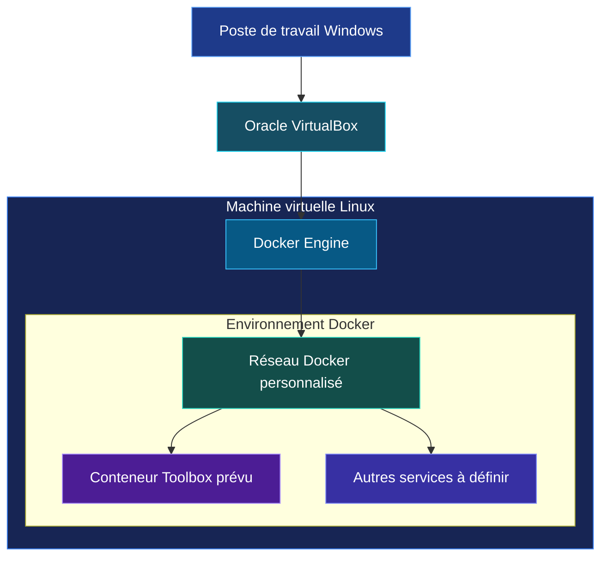

 <div align="center">


<br>


<br>

[](https://www.etml.ch/)
[](https://github.com/RufusTheDwarf/Docker-Network-Toolkit)
[](https://www.linux.org/)
[](https://www.virtualbox.org/)
[](https://www.docker.com/)
[](https://docs.docker.com/compose/)
[](https://docs.docker.com/engine/network/)
[](https://www.kernel.org/)
[](https://www.gnu.org/software/bash/)
[](https://yaml.org/)
[](https://git-scm.com/)
[](https://www.docker.com/)
[](https://github.com/RufusTheDwarf/Docker-Network-Toolkit)
[](LICENSE)

<br>

[](https://github.com/RufusTheDwarf/Docker-Network-Toolkit/stargazers)
[](https://github.com/RufusTheDwarf/Docker-Network-Toolkit/forks)
[](https://github.com/RufusTheDwarf/Docker-Network-Toolkit/issues)
[](https://github.com/RufusTheDwarf/Docker-Network-Toolkit/commits/main)
[](https://github.com/RufusTheDwarf/Docker-Network-Toolkit/tree/main)

<br>

**A containerized network and system toolkit for infrastructure students and enthusiasts.**

[**Repository**](https://github.com/RufusTheDwarf/Docker-Network-Toolkit) · [**Docker Documentation**](https://docs.docker.com/) · [**Report an issue**](https://github.com/RufusTheDwarf/Docker-Network-Toolkit/issues)

</div>

<p align="center">

</p>

<div align="center">


<sub>Illustrative server-room photograph. This is not a photograph of the project's actual virtual infrastructure.</sub>

<br>


</div>

## Présentation

**Docker Network Toolkit** est un projet pédagogique réalisé dans le cadre de la formation informatique à l'ETML.

L'objectif est de développer une boîte à outils conteneurisée destinée aux personnes qui travaillent dans l'infrastructure informatique.

Le projet vise à regrouper plusieurs outils de diagnostic réseau et système dans un environnement Docker, hébergé au sein d'une machine virtuelle Linux exécutée avec Oracle VirtualBox.

L'idée est de construire un véritable petit laboratoire d'infrastructure permettant de comprendre comment les machines virtuelles, les conteneurs, les réseaux virtuels et les services communiquent entre eux.

### Ce que le projet cherche à apporter

- Regrouper des outils réseau et système dans un environnement organisé.
- Construire des images Docker personnalisées.
- Déployer et gérer plusieurs conteneurs.
- Comprendre les réseaux virtuels Docker.
- Étudier la communication entre conteneurs et avec la machine hôte.
- Apprendre à administrer un environnement Linux.
- Documenter et diagnostiquer une infrastructure technique.

<p align="center">

</p>

## État actuel du projet

<badge color="warning">Squelette initial en développement</badge>

Le dépôt est actuellement une base de travail. Les objectifs d'architecture sont définis, mais l'infrastructure Docker complète n'est pas encore implémentée.

Voici ce qui existe réellement sur la branche `main` :

| Élément | État observé |
|---|---|
| README.md | Documentation du projet |
| LICENSE | Licence MIT |
| `containers/toolbox/Dockerfile` | Présent, actuellement vide |
| `scripts/script.txt` | Présent, actuellement vide |
| `docs/rapport-technique/JDT.txt` | Journal de travail |
| `compose.yaml` | Absent |
| `.gitignore` | Absent |
| Images Docker personnalisées | Pas encore implémentées |
| Services Docker Compose | Pas encore définis |
| Scripts d'installation et de lancement | Pas encore implémentés |
| Tests automatisés | Aucun présent |

**Important :** le projet ne peut pas encore être déployé avec `docker compose up`, car aucun fichier Compose n'est présent et le Dockerfile est vide.

Les architectures et procédures présentées ci-dessous décrivent les objectifs techniques et les connaissances visées. Elles ne doivent pas être interprétées comme des composants déjà opérationnels.

<p align="center">

</p>

## Ce que ce projet va nous apprendre

Ce projet est particulièrement intéressant pour comprendre ce qui se passe derrière les systèmes informatiques et les infrastructures d'entreprise.

Il permet de travailler sur plusieurs notions fondamentales de l'administration système et réseau.

<div align="center">

[](#1-virtualisation-avec-virtualbox)
[](#2-administration-linux)
[](#3-conteneurs-et-images-docker)
[](#4-réseaux-docker)
[](#5-docker-compose)
[](#6-sécurité-et-isolation)

</div>

### 1. Virtualisation avec VirtualBox


Avant de construire des conteneurs, il faut comprendre l'environnement dans lequel ils vont fonctionner.

VirtualBox permet de créer une machine virtuelle Linux sur un poste Windows.

Tu découvriras :

- Le rôle d'un hyperviseur.
- La différence entre une machine physique et une machine virtuelle.
- Les ressources CPU, RAM et stockage.
- Les cartes réseau virtuelles.
- La communication entre le système hôte et le système invité.
- Les modes réseau NAT, Bridged et Host-only.

### 2. Administration Linux


La machine virtuelle Linux sert d'hôte à Docker.

Ce projet permet donc de travailler sur l'administration d'un environnement Linux.

Les notions à apprendre comprennent :

- L'organisation du système de fichiers.
- La gestion des utilisateurs et des groupes.
- Les permissions et les propriétaires.
- L'installation des paquets.
- La gestion des dépendances.
- Les services système.
- Les interfaces réseau.
- Les adresses IP, routes et passerelles.
- Les journaux système.
- Les commandes de diagnostic.

### 3. Conteneurs et images Docker


Docker permet d'exécuter une application ou un ensemble d'outils dans un environnement isolé.

Tu découvriras la différence entre :

| Image Docker | Conteneur Docker |
|---|---|
| Modèle utilisé pour créer un environnement | Instance en cours d'exécution d'une image |
| Contient les dépendances et fichiers nécessaires | Exécute les processus |
| Peut être versionnée et réutilisée | Peut être arrêté, supprimé ou recréé |
| Construite à partir d'un Dockerfile | Créé à partir d'une image |

Les concepts étudiés :

- Docker Engine.
- Images et couches.
- Dockerfile.
- Build et cache de construction.
- Registres d'images.
- Variables d'environnement.
- Volumes.
- Cycle de vie des conteneurs.
- Isolation des processus.

### 4. Réseaux Docker


La partie centrale du projet est la communication réseau entre les différents conteneurs.

Tu apprendras notamment :

- Le fonctionnement des réseaux virtuels.
- Les réseaux bridge.
- Les sous-réseaux.
- Les adresses IP.
- Les passerelles.
- La résolution DNS entre services.
- La publication de ports.
- La séparation des réseaux.
- Les communications entre conteneurs.
- Le diagnostic des problèmes de connectivité.

Un point fondamental : les conteneurs appartenant au même réseau Docker peuvent communiquer directement. Avec Docker Compose, les services peuvent se retrouver par leur nom DNS sur le réseau partagé.

Cela évite de devoir dépendre d'adresses IP fixes, qui peuvent changer lors de la recréation des conteneurs.

### 5. Docker Compose


Docker Compose permet de définir plusieurs services dans un seul fichier YAML.

Au lieu de gérer chaque conteneur séparément, l'ensemble de l'environnement peut être décrit dans une configuration.

Les notions à apprendre :

- Déclaration des services.
- Construction des images.
- Variables d'environnement.
- Dépendances entre services.
- Réseaux personnalisés.
- Volumes persistants.
- Publication des ports.
- Démarrage et arrêt coordonnés.

### 6. Sécurité et isolation


Un environnement conteneurisé doit être conçu avec des règles de sécurité.

Le projet doit notamment permettre de comprendre :

- L'isolation des services.
- Les permissions Linux.
- L'exécution avec un utilisateur non privilégié.
- La gestion des secrets.
- Les ports exposés.
- Les capacités Linux.
- Les réseaux internes.
- Les privilèges accordés aux conteneurs.

L'objectif est d'éviter d'accorder des permissions excessives simplement pour faire fonctionner un outil.

### Compétences développées

| Domaine | Compétences |
|---|---|
| Systèmes | Linux, paquets, utilisateurs, services |
| Virtualisation | VirtualBox, cartes réseau virtuelles |
| Conteneurisation | Docker, images, conteneurs |
| Réseau | IP, DNS, bridge, ports, routage |
| Orchestration | Docker Compose et YAML |
| Automatisation | Bash et scripts système |
| Sécurité | Isolation et permissions |
| Dépannage | Logs, inspection et diagnostic |
| Documentation | Architecture et procédures techniques |

<p align="center">

</p>

## Architecture cible

L'infrastructure visée repose sur trois niveaux :

1. Le poste de travail Windows.
2. Une machine virtuelle Linux hébergée dans VirtualBox.
3. Docker Engine et les conteneurs exécutés dans cette machine virtuelle.

<div align="center">


<sub>Exemple visuel d'infrastructure physique. Le projet utilise une architecture de laboratoire virtualisée.</sub>

</div>

### Schéma général

<badge color="info">Architecture prévue</badge>



Ce schéma représente l'organisation visée. Les services supplémentaires, les adresses et la configuration réseau restent à définir.

### Les différents niveaux réseau

| Niveau | Responsabilité |
|---|---|
| Windows | Poste de travail et système hôte |
| VirtualBox | Virtualisation et connectivité de la VM |
| Linux | Système d'exploitation invité |
| Docker Engine | Gestion des conteneurs et des réseaux |
| Réseau Docker | Communication entre services |
| Conteneurs | Exécution des outils |

### Comprendre les modes réseau de VirtualBox

Le mode réseau choisi détermine comment la machine virtuelle communique avec le poste de travail et le réseau physique.

| Mode | Fonctionnement |
|---|---|
| NAT | La VM peut accéder au réseau externe. Les connexions entrantes nécessitent notamment une redirection de ports. |
| Bridged | La VM est connectée au réseau physique comme une machine distincte. |
| Host-only | La VM communique avec le poste hôte sans être directement exposée au réseau physique. |
| NAT Network | Plusieurs VM peuvent partager un réseau NAT. |

Le mode final devra être choisi selon les besoins de communication et les règles de sécurité du laboratoire.

Documentation : [VirtualBox Networking](https://docs.oracle.com/en/virtualization/virtualbox/7.2/user/networkingdetails.html).

<p align="center">

</p>

## Réseaux Docker

La communication entre conteneurs constitue l'une des parties principales du projet.

### Réseau Bridge

Le driver `bridge` permet de connecter plusieurs conteneurs sur un même réseau virtuel.

Les conteneurs peuvent communiquer entre eux sans devoir exposer chaque port sur le réseau physique.

Les points à étudier :

- Création et suppression d'un réseau.
- Attribution d'adresses IP.
- Passerelle du réseau.
- DNS et résolution des noms.
- Isolation entre réseaux.
- Publication de ports.

### Communication entre services

Docker Compose crée généralement un réseau par défaut pour un projet.

Les services connectés à ce réseau peuvent se retrouver par leur nom de service.

Exemple conceptuel :

```text
                    Docker Network
                    Bridge
                       |
          +------------+------------+
          |            |            |
     Container A  Container B  Container C
          |            |            |
       Service A   Service B   Service C
```

Dans cette configuration, un service peut contacter un autre service en utilisant son nom et le port interne concerné.

### Ports internes et externes

Il faut distinguer deux notions :

| Port | Rôle |
|---|---|
| Port du conteneur | Port utilisé par le service dans le conteneur |
| Port de l'hôte | Port publié pour rendre le service accessible depuis l'extérieur |

Par exemple, une publication telle que `8080:80` fait correspondre le port `8080` de l'hôte au port `80` du conteneur.

Attention : l'accès depuis Windows dépend également du mode réseau choisi dans VirtualBox et de la configuration de la VM.

### Pourquoi utiliser des réseaux personnalisés ?

Les réseaux personnalisés permettent de séparer des groupes de services.

Un service qui doit seulement communiquer avec une base de données ne doit pas nécessairement partager le même réseau que tous les autres conteneurs.

Cette organisation facilite :

- L'isolation.
- La réduction des communications inutiles.
- La lisibilité de l'architecture.
- Le diagnostic des problèmes.
- La limitation des accès.

Références : [Docker Networking](https://docs.docker.com/engine/network/) et [Compose Networking](https://docs.docker.com/compose/how-tos/networking/).

<p align="center">

</p>

## Environnement technique

### Technologies principales

<div align="center">


<br>

[](https://docs.docker.com/engine/)
[](https://docs.docker.com/compose/)
[](https://www.kernel.org/)
[](https://www.gnu.org/software/bash/)
[](https://yaml.org/)
[](https://www.virtualbox.org/)

</div>

### Environnement prévu

| Élément | Choix |
|---|---|
| Poste hôte | Windows |
| Hyperviseur | Oracle VirtualBox |
| Système invité | Distribution Linux à confirmer |
| Conteneurisation | Docker Engine |
| Orchestration | Docker Compose |
| Images personnalisées | Dockerfile |
| Configuration | YAML |
| Automatisation | Bash |
| Gestion de versions | Git / GitHub |

La distribution Linux définitive et les versions exactes des composants ne sont pas encore fixées dans le dépôt.

Les versions devront être précisées avant de pouvoir produire une procédure d'installation reproductible.

<p align="center">

</p>

## Installation et préparation

Le dépôt n'est pas encore prêt à déployer une stack Docker. Cette section décrit la préparation de l'environnement et les premières vérifications utiles.

### Prérequis

- Un ordinateur capable d'exécuter une machine virtuelle.
- Oracle VirtualBox.
- Une machine virtuelle Linux.
- Docker Engine installé dans la machine virtuelle.
- Docker Compose disponible.
- Git.
- Un accès Internet pour l'installation des dépendances.

### 1. Récupérer le dépôt

```bash
git clone https://github.com/RufusTheDwarf/Docker-Network-Toolkit.git

cd Docker-Network-Toolkit
```

### 2. Vérifier Docker

Dans le terminal Linux de la machine virtuelle :

```bash
docker --version
```

Vérifier Docker Compose :

```bash
docker compose version
```

Vérifier le fonctionnement du moteur Docker :

```bash
docker info
```

Ces commandes vérifient l'environnement Docker. Elles ne déploient pas encore le projet.

### 3. Explorer les réseaux Docker

Lister les réseaux disponibles :

```bash
docker network ls
```

Inspecter le réseau bridge par défaut :

```bash
docker network inspect bridge
```

Afficher les informations réseau de Linux :

```bash
ip -br addr
```

Afficher la table de routage :

```bash
ip route
```

Vérifier les ports en écoute :

```bash
ss -lntup
```

Ces commandes permettent de commencer à comprendre les interfaces, les routes, les réseaux Docker et les services actifs.

### 4. Déploiement futur avec Compose

Une fois le fichier `compose.yaml` créé et les images configurées, le processus de déploiement visé sera :

```bash
docker compose config
docker compose up --build -d
docker compose ps
docker compose logs -f
```

Pour arrêter l'environnement :

```bash
docker compose down
```

**Ces commandes ne sont pas encore exécutables dans le dépôt actuel**, car le fichier `compose.yaml` n'existe pas.

<p align="center">

</p>

## Diagnostic et dépannage

Un laboratoire réseau est aussi utile pour apprendre à diagnostiquer une panne.

Les commandes suivantes serviront à inspecter les futurs conteneurs.

| Commande | Utilité |
|---|---|
| `docker ps -a` | Lister les conteneurs |
| `docker images` | Lister les images |
| `docker network ls` | Lister les réseaux |
| `docker network inspect NOM` | Examiner un réseau |
| `docker inspect NOM` | Examiner un conteneur |
| `docker logs NOM` | Consulter les journaux |
| `docker exec -it NOM sh` | Ouvrir un shell dans un conteneur |
| `docker port NOM` | Afficher les ports publiés |

### Tests réseau à prévoir

Une fois les services implémentés, le projet devra permettre de vérifier :

1. La présence des conteneurs sur le réseau prévu.
2. La résolution DNS des noms de services.
3. La connectivité entre les conteneurs.
4. La cohérence des adresses IP et des routes.
5. L'accès aux ports publiés.
6. La communication entre Windows, la VM et Docker.
7. Le comportement lors d'un arrêt et d'un redémarrage.

Les outils de test tels que `ping`, `curl`, `dig` ou `nc` devront être disponibles dans les environnements concernés avant de les utiliser.

La réussite d'un test ne doit pas être supposée simplement parce que les conteneurs démarrent.

## Sécurité et bonnes pratiques

La conteneurisation ne signifie pas qu'un service est automatiquement sécurisé.

Le projet devra respecter plusieurs principes.

### Isolation

- Séparer les services qui n'ont pas besoin de communiquer.
- Utiliser des réseaux internes lorsque c'est pertinent.
- Publier uniquement les ports nécessaires.
- Éviter les modes réseau privilégiés sans justification.

### Gestion des privilèges

- Éviter l'exécution en root lorsque cela est possible.
- Ne pas utiliser `privileged: true` par défaut.
- Accorder uniquement les capacités Linux nécessaires.
- Limiter l'accès au démon Docker.

Certains outils de diagnostic réseau nécessitent des permissions particulières. Elles devront être documentées et justifiées individuellement.

### Protection des informations

- Ne jamais placer de mots de passe dans un Dockerfile.
- Ne pas versionner les fichiers contenant des secrets.
- Utiliser des variables ou mécanismes adaptés pour les paramètres sensibles.
- Examiner les permissions des fichiers.
- Utiliser des images de base fiables et des versions contrôlées.

### Environnement de test

Les tests doivent rester dans un laboratoire ou sur des réseaux pour lesquels tu disposes d'une autorisation.

Le projet est pédagogique et ne doit pas être présenté comme une solution de surveillance ou de sécurité prête pour la production.

Références : [Docker Engine Security](https://docs.docker.com/engine/security/) · [Docker Build Best Practices](https://docs.docker.com/build/building/best-practices/).

<p align="center">

</p>

## Tests et validation

Aucun système de tests automatisés n'est actuellement présent dans le dépôt.

Les validations à réaliser au fur et à mesure de l'implémentation sont :

| Test | Objectif |
|---|---|
| Validation Dockerfile | Vérifier la construction de chaque image |
| Validation Compose | Vérifier la syntaxe et la configuration YAML |
| Démarrage | Vérifier le lancement des services |
| Réseau | Vérifier la présence des conteneurs sur les réseaux attendus |
| DNS | Vérifier la résolution des noms de services |
| Ports | Vérifier les publications et les accès |
| Sécurité | Vérifier les privilèges et les ports exposés |
| Persistance | Vérifier les volumes et les données |
| Redémarrage | Vérifier le comportement après arrêt des services |

### Commandes de validation prévues

Lorsque la stack sera créée :

```bash
docker compose config
docker compose build
docker compose up -d
docker compose ps
docker compose logs
docker compose down
```

Ces validations sont une procédure cible, pas des tests déjà exécutés.

<p align="center">

</p>

## Feuille de route

Le développement peut être organisé en étapes progressives.

<badge color="success">Base de documentation présente</badge>

**Étape 1 : préparation de l'environnement**

- [x] Création du dépôt GitHub.
- [x] Création du dossier de documentation.
- [x] Création du premier dossier de conteneur.
- [ ] Finaliser l'installation de Linux.
- [ ] Installer Docker Engine.
- [ ] Installer et vérifier Docker Compose.
- [ ] Documenter les versions exactes.

**Étape 2 : construction des images**

- [ ] Définir les outils à intégrer.
- [ ] Compléter le Dockerfile Toolbox.
- [ ] Choisir et fixer une image de base.
- [ ] Installer les paquets nécessaires.
- [ ] Construire et vérifier l'image.
- [ ] Documenter les dépendances.

**Étape 3 : orchestration**

- [ ] Créer `compose.yaml`.
- [ ] Déclarer les services.
- [ ] Définir les réseaux.
- [ ] Configurer les variables nécessaires.
- [ ] Définir les volumes éventuels.
- [ ] Vérifier le démarrage de l'ensemble.

**Étape 4 : réseau et diagnostic**

- [ ] Vérifier les communications entre services.
- [ ] Vérifier la résolution DNS.
- [ ] Contrôler les ports exposés.
- [ ] Documenter les sous-réseaux et passerelles.
- [ ] Tester les communications depuis la VM.
- [ ] Tester les accès depuis Windows.

**Étape 5 : documentation et livraison**

- [ ] Finaliser le schéma réseau.
- [ ] Documenter les commandes.
- [ ] Ajouter les résultats de tests réels.
- [ ] Documenter les limitations.
- [ ] Finaliser le rapport technique.
- [ ] Préparer la présentation du projet.

<p align="center">

</p>

## Organisation du dépôt

L'arborescence ci-dessous correspond aux fichiers réellement présents sur `main`.

```text
Docker-Network-Toolkit/
│
├── LICENSE
├── README.md
│
├── containers/
│   └── toolbox/
│       └── Dockerfile
│
├── docs/
│   └── rapport-technique/
│       └── JDT.txt
│
└── scripts/
    └── script.txt
```

### Détail des fichiers

| Chemin | Description |
|---|---|
| `README.md` | Présentation et documentation du projet |
| `LICENSE` | Licence MIT |
| `containers/toolbox/Dockerfile` | Emplacement prévu pour l'image Toolbox, actuellement vide |
| `docs/rapport-technique/JDT.txt` | Journal de travail et suivi des activités |
| `scripts/script.txt` | Fichier présent, actuellement vide |

### Journal de travail

Le fichier `docs/rapport-technique/JDT.txt` permet de suivre le temps consacré au projet.

Il contient notamment des entrées datées du 4 novembre 2026, avec cinq périodes de 45 minutes consacrées à l'introduction, à l'installation et à la préparation de l'environnement.

Les dates suivantes contiennent encore des emplacements de suivi vides. Elles ne constituent donc pas des étapes déjà réalisées.

<p align="center">

</p>

## Documentation et références techniques

Les ressources officielles suivantes servent de base pour le développement du projet.

<div align="center">

[](https://docs.docker.com/)
[](https://docs.docker.com/compose/)
[](https://www.virtualbox.org/)
[](https://www.debian.org/doc/)
[](https://www.kernel.org/)
[](https://www.gnu.org/software/bash/)

</div>

| Ressource | Sujet |
|---|---|
| [Docker Engine](https://docs.docker.com/engine/) | Gestion des conteneurs |
| [Docker Networking](https://docs.docker.com/engine/network/) | Réseaux et connectivité |
| [Compose Networking](https://docs.docker.com/compose/how-tos/networking/) | Communication entre services |
| [Dockerfile Reference](https://docs.docker.com/reference/dockerfile/) | Construction des images |
| [Docker Build Best Practices](https://docs.docker.com/build/building/best-practices/) | Images et bonnes pratiques |
| [Docker Engine Security](https://docs.docker.com/engine/security/) | Sécurité de l'environnement |
| [Docker Volumes](https://docs.docker.com/engine/storage/volumes/) | Persistance des données |
| [VirtualBox Networking](https://docs.oracle.com/en/virtualization/virtualbox/7.2/user/networkingdetails.html) | Modes réseau des machines virtuelles |
| [Debian Reference](https://www.debian.org/doc/manuals/debian-reference/ch05) | Configuration réseau Linux |
| [GNU Bash](https://www.gnu.org/software/bash/manual/) | Automatisation et scripts |

## Contribution

Les améliorations, corrections et propositions sont les bienvenues.

Pour contribuer :

1. Forker le dépôt.
2. Créer une branche dédiée.
3. Effectuer les modifications.
4. Vérifier les fichiers et les commandes.
5. Ouvrir une Pull Request.

Exemple :

```bash
git switch -c feature/network-tool
git add .
git commit -m "feat: add network diagnostic tool"
git push origin feature/network-tool
```

Ne pas inclure de secrets, de mots de passe ou de fichiers de configuration personnels dans les contributions.

## Licence

Ce projet est distribué sous la **licence MIT**.

Voir le fichier [LICENSE](LICENSE) pour les conditions complètes.

Copyright (c) 2026 Rufus.

---

## Remerciements et crédits

Ce projet s'appuie sur le travail des équipes qui développent et maintiennent les technologies de virtualisation, de conteneurisation, de réseau et les outils open source utilisés pour apprendre l'infrastructure.

### Technologies et projets

- [**Docker**](https://www.docker.com/) pour la technologie de conteneurisation.
- [**Docker Compose**](https://github.com/docker/compose) pour l'orchestration des services.
- [**Linux Kernel**](https://www.kernel.org/) pour les fondations du système Linux.
- [**Debian Project**](https://www.debian.org/) pour la distribution Linux et sa documentation.
- [**Oracle VirtualBox**](https://www.virtualbox.org/) pour la virtualisation.
- [**GNU Project**](https://www.gnu.org/) pour Bash et les outils associés.
- [**Git**](https://git-scm.com/) pour le contrôle de version.
- [**GitHub**](https://github.com/) pour l'hébergement du dépôt et la collaboration.

### Images et ressources graphiques

- **Fleshas / BalticServers.com** pour la photographie *BalticServers data center.jpg*, distribuée sous [CC BY-SA 3.0](https://creativecommons.org/licenses/by-sa/3.0/). [Source originale](https://commons.wikimedia.org/wiki/File:BalticServers_data_center.jpg).
- **PiDatacenters** pour la photographie *Racks Amravati Data Center.jpg*, distribuée sous [CC BY-SA 4.0](https://creativecommons.org/licenses/by-sa/4.0/). [Source originale](https://commons.wikimedia.org/wiki/File:Racks_Amravati_Data_Center.jpg).
- [**Capsule Render**](https://github.com/kyechan99/capsule-render) pour les bannières et séparateurs SVG.
- [**Readme Typing SVG**](https://github.com/DenverCoder1/readme-typing-svg) pour le texte animé.
- [**Skill Icons**](https://github.com/tandpfun/skill-icons) pour les icônes technologiques.
- [**Iconify**](https://iconify.design/) pour les icônes SVG.
- [**Shields.io**](https://shields.io/) pour les badges.

Les photographies sont utilisées comme illustrations d'ambiance et ne représentent pas l'infrastructure réelle du projet.

Docker est une marque de Docker, Inc. Son utilisation dans cette documentation est uniquement informative. Ce projet n'est ni sponsorisé ni approuvé par Docker, Inc.

Merci aux mainteneurs, contributeurs et auteurs de ces ressources qui rendent l'apprentissage de l'informatique et de l'infrastructure accessible.

---

<div align="center">


### DOCKER NETWORK TOOLKIT

**Diagnostiquer. Connecter. Isoler. Comprendre.**

<br>

[](https://github.com/RufusTheDwarf)
[](https://github.com/RufusTheDwarf/Docker-Network-Toolkit)
[](LICENSE)
[](https://github.com/RufusTheDwarf/Docker-Network-Toolkit)
[](https://www.docker.com/)
[](https://www.kernel.org/)

<br>

[](https://github.com/RufusTheDwarf/Docker-Network-Toolkit/stargazers)
[](https://github.com/RufusTheDwarf/Docker-Network-Toolkit/issues)
[](https://github.com/RufusTheDwarf/Docker-Network-Toolkit/fork)

<br>

<sub>Designed and maintained by <strong>RufusTheDwarf</strong></sub>

<sub>Educational infrastructure project · ETML · 2026 · MIT License</sub>

<br>

**Build the lab. Understand the network. Master the infrastructure.**


</div>
