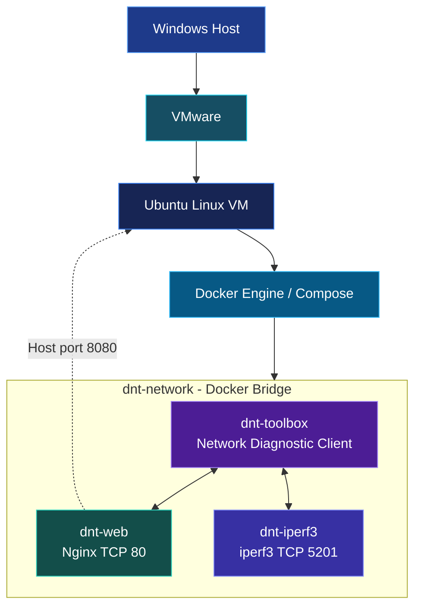

<div align="center">


<br>


<br>

[](https://www.etml.ch/)
[](https://github.com/RufusTheDwarf/Docker-Network-Toolkit)
[](https://www.kernel.org/)
[](https://www.vmware.com/)
[](https://www.docker.com/)
[](https://docs.docker.com/compose/)
[](https://docs.docker.com/engine/network/)
[](https://www.gnu.org/software/bash/)
[](https://yaml.org/)
[](https://git-scm.com/)
[](https://github.com/RufusTheDwarf/Docker-Network-Toolkit)
[](LICENSE)

<br>

[](https://github.com/RufusTheDwarf/Docker-Network-Toolkit/stargazers)
[](https://github.com/RufusTheDwarf/Docker-Network-Toolkit/forks)
[](https://github.com/RufusTheDwarf/Docker-Network-Toolkit/issues)
[](https://github.com/RufusTheDwarf/Docker-Network-Toolkit/commits/main)
[](https://github.com/RufusTheDwarf/Docker-Network-Toolkit/tree/main)

<br>

**A containerized network and system toolkit for infrastructure students and enthusiasts.**

[**Repository**](https://github.com/RufusTheDwarf/Docker-Network-Toolkit) ·
[**Docker Documentation**](https://docs.docker.com/) ·
[**Report an issue**](https://github.com/RufusTheDwarf/Docker-Network-Toolkit/issues)

</div>

<p align="center">

</p>

<div align="center">


<sub>Photographie d'illustration. Elle ne représente pas l'infrastructure virtuelle réelle du projet.</sub>

<br>


</div>

## Présentation

**Docker Network Toolkit** est un projet pédagogique réalisé dans le cadre de la formation informatique à l'ETML.

L'objectif est de concevoir, déployer et administrer un laboratoire réseau conteneurisé permettant d'expérimenter les technologies Docker, Linux, la virtualisation et les outils de diagnostic réseau.

L'infrastructure est hébergée dans une machine virtuelle Ubuntu exécutée avec VMware sur un poste Windows.

Elle repose sur **Docker Engine**, **Docker Compose** et un réseau virtuel de type `bridge`.

Le projet permet de comprendre concrètement la communication entre un système hôte, une machine virtuelle et plusieurs conteneurs.

### Objectifs principaux

- Construire des images Docker personnalisées.
- Déployer plusieurs services avec Docker Compose.
- Comprendre les réseaux Docker et leur isolation.
- Diagnostiquer les communications réseau.
- Observer les interfaces, adresses IP, routes et ports.
- Mesurer les performances avec iperf3.
- Effectuer des diagnostics HTTP avec curl.
- Examiner les ports avec Nmap.
- Automatiser les vérifications avec Bash.
- Appliquer les bonnes pratiques de sécurité.
- Versionner et documenter les configurations avec Git et GitHub.

---

## État actuel du projet


Le cœur de l'infrastructure Docker Network Toolkit est opérationnel.

Les trois services ont été déployés avec Docker Compose et les principaux tests réseau ont réussi le **18 novembre 2026**.

| Composant | État |
|---|---|
| Machine virtuelle Ubuntu sur VMware | Opérationnelle |
| Docker Engine | Installé et fonctionnel |
| Docker Compose | Fonctionnel |
| Image Toolbox personnalisée | Construite et testée |
| Image iperf3 personnalisée | Construite et utilisée |
| Serveur web Nginx | Opérationnel |
| Réseau Docker `dnt-network` | Opérationnel |
| Résolution DNS inter-conteneurs | Validée |
| Connectivité ICMP | Validée |
| Service HTTP | Validé |
| Scan TCP avec Nmap | Validé |
| Mesure réseau avec iperf3 | Validée |
| Script de tests Bash | Fonctionnel |
| Git et signatures SSH | Configurés |
| Publication GitHub | Fonctionnelle |
| CI GitHub Actions | Opérationnelle. tests automatisés validés |
| Durcissement de sécurité | À approfondir |

Les résultats présentés correspondent aux essais réalisés dans le laboratoire. Ils ne constituent pas une certification de sécurité ni une validation de production.

<p align="center">

</p>

## Ce que ce projet permet d'apprendre

<div align="center">

[](#1-virtualisation-avec-vmware)
[](#2-administration-linux)
[](#3-conteneurs-et-images-docker)
[](#4-réseaux-docker)
[](#5-docker-compose)
[](#6-sécurité-et-isolation)

</div>

### 1. Virtualisation avec VMware


Le laboratoire utilise une machine virtuelle Linux pour héberger les services Docker.

La virtualisation permet d'expérimenter sans devoir déployer directement les services sur le système Windows.

Notions étudiées :

- Hyperviseur et machines virtuelles.
- Ressources CPU, RAM et stockage.
- Interfaces réseau virtuelles.
- Communication entre hôte et invité.
- NAT et réseau bridge.
- Adresses IP et passerelles.
- VMware VMnet8.

### 2. Administration Linux


Ubuntu constitue le système d'exploitation invité.

Le projet permet de travailler sur :

- Les commandes du terminal.
- Les fichiers et les répertoires.
- Les permissions Linux.
- L'installation des paquets.
- Les services système.
- La configuration réseau.
- Les processus.
- Les journaux et les diagnostics.

### 3. Conteneurs et images Docker


Docker permet d'exécuter des services dans des environnements isolés et reproductibles.

| Image Docker | Conteneur Docker |
|---|---|
| Modèle de fichiers et configuration | Instance créée à partir d'une image |
| Construite avec un Dockerfile | Créée avec `docker run` ou Compose |
| Réutilisable et versionnable | Possède son propre état d'exécution |
| Peut posséder plusieurs tags | Peut être démarré, arrêté ou supprimé |

Les exercices du dépôt abordent la construction d'images, les tags, l'inspection et le cycle de vie des conteneurs.

### 4. Réseaux Docker


Les conteneurs communiquent au travers d'un réseau Docker personnalisé.

Notions étudiées :

- Réseaux `bridge`.
- Sous-réseaux et passerelles.
- Résolution DNS intégrée.
- Communication par nom de service.
- Ports internes et publiés.
- Inspection des interfaces.
- Isolation entre réseaux.

### 5. Docker Compose


Docker Compose permet de définir plusieurs services dans un fichier YAML unique.

Le projet utilise `compose.yaml` pour gérer :

- La construction des images.
- Les services Toolbox, Nginx et iperf3.
- Les noms des conteneurs.
- Le réseau Docker personnalisé.
- Le port HTTP publié.
- Les volumes de configuration.
- Les options de redémarrage.

### 6. Sécurité et isolation


La sécurité fait partie intégrante du laboratoire.

Les principaux sujets sont :

- Les utilisateurs non privilégiés.
- Les capacités Linux.
- Les permissions Docker.
- La protection des secrets.
- L'exposition des ports.
- L'isolation des services.
- La gestion des images et de leurs versions.

---

## Architecture du laboratoire

L'infrastructure est organisée en trois niveaux :

1. **Windows** : poste de travail hôte.
2. **VMware et Ubuntu** : virtualisation et système invité.
3. **Docker Engine et Compose** : exécution des conteneurs et gestion des réseaux.

<div align="center">


<sub>Illustration d'une infrastructure de serveurs. Le laboratoire réel fonctionne dans une machine virtuelle.</sub>

</div>

### Schéma général



### Services Docker

| Service Compose | Conteneur | Fonction |
|---|---|---|
| `toolbox` | `dnt-toolbox` | Client de diagnostic réseau |
| `web` | `dnt-web` | Serveur web Nginx |
| `iperf3-server` | `dnt-iperf3` | Serveur de mesure réseau |

### Réseau Docker


Le projet utilise un réseau Docker personnalisé nommé :

`dnt-network`

Les services communiquent directement au moyen de leurs noms DNS.

Depuis la Toolbox :

```bash
getent hosts web
getent hosts iperf3-server
ping -c 3 web
curl -fsS http://web/
```

Le réseau Docker attribue automatiquement les adresses aux conteneurs.

### Adresses observées pendant les tests

| Service | Adresse IP observée |
|---|---|
| Toolbox | `172.18.0.4` |
| Nginx | `172.18.0.3` |
| iperf3 | `172.18.0.2` |

Ces adresses ont été relevées le 18 novembre 2026. Elles peuvent changer lors de la recréation des conteneurs ou du réseau.

Les communications doivent donc privilégier les noms DNS plutôt que des adresses IP codées en dur.

### Ports internes et externes

| Service | Port interne | Port publié sur la VM |
|---|---|---|
| Nginx | TCP 80 | TCP 8080 |
| iperf3 | TCP 5201 | Aucun |
| Toolbox | Aucun serveur | Aucun |

Le port TCP 5201 reste accessible entre les conteneurs raccordés au réseau du projet, mais n'est pas publié directement sur la VM.

Le port TCP 8080 permet d'accéder à Nginx depuis le système hôte si la configuration réseau et les règles de pare-feu l'autorisent.

### Communication VMware

Le laboratoire utilise le réseau virtuel VMware `VMnet8`, associé à une configuration NAT lors des essais documentés.

Un test depuis Windows PowerShell a confirmé l'accès au serveur Nginx :

| Paramètre | Valeur |
|---|---|
| Interface Windows | VMware Network Adapter VMnet8 |
| Adresse Windows | `192.168.196.1` |
| Adresse VM Ubuntu | `192.168.196.131` |
| Port distant | TCP 8080 |
| Résultat | `TcpTestSucceeded: True` |

Adresse utilisée pendant cet essai :

`http://192.168.196.131:8080`

Cette adresse dépend de la configuration locale VMware et n'est pas une adresse publique permanente.

Documentation complémentaire : [Architecture réseau](docs/architecture/network.md).

<p align="center">

</p>

## Environnement technique

### Technologies principales

<div align="center">


<br>

[](https://docs.docker.com/engine/)
[](https://docs.docker.com/compose/)
[](https://ubuntu.com/)
[](https://www.vmware.com/)
[](https://git-scm.com/)

</div>

| Élément | Technologie |
|---|---|
| Poste hôte | Windows |
| Hyperviseur | VMware |
| Système invité | Ubuntu Linux |
| Conteneurisation | Docker Engine |
| Orchestration | Docker Compose |
| Image Toolbox | Ubuntu 24.04 |
| Image iperf3 | Debian Trixie Slim |
| Serveur web | Nginx Alpine |
| Scripts | Bash |
| Configuration | YAML |
| Gestion de versions | Git / GitHub |
| Signature des commits | SSH Ed25519 |

Docker Engine 29.9.3 a été observé dans les logs du laboratoire du 11 novembre 2026.

Les autres versions doivent être relevées et documentées pour améliorer la reproductibilité.

---

## Installation et déploiement

### Prérequis

- Une machine Linux avec Docker Engine installé.
- Docker Compose disponible via `docker compose`.
- Git.
- Une connexion réseau permettant de télécharger les images et paquets nécessaires.
- Des ressources suffisantes pour les trois services.

Le projet a été testé dans une machine virtuelle Ubuntu sur VMware.

### 1. Récupérer le dépôt

```bash
git clone https://github.com/RufusTheDwarf/Docker-Network-Toolkit.git

cd Docker-Network-Toolkit
```

### 2. Vérifier Docker

```bash
docker --version
docker compose version
docker info
```

### 3. Vérifier la configuration Compose

```bash
docker compose config
```

Pour vérifier uniquement la validité de la configuration :

```bash
docker compose config -q
```

### 4. Construire les images

```bash
docker compose build
```

Pour reconstruire sans réutiliser le cache de build :

```bash
docker compose build --no-cache
```

### 5. Démarrer les services

```bash
docker compose up -d
```

Lors d'un premier déploiement :

```bash
docker compose up --build -d
```

Afficher les conteneurs du projet :

```bash
docker compose ps
```

### 6. Vérifier les services

Depuis la machine virtuelle :

```bash
curl -I http://localhost:8080
```

Ouvrir un shell dans la Toolbox :

```bash
docker compose exec toolbox bash
```

Depuis la Toolbox :

```bash
ip address
ip route
getent hosts web
getent hosts iperf3-server
```

### 7. Exécuter la suite de tests

```bash
bash scripts/test-stack.sh
```

Le script vérifie la résolution DNS, la connectivité ICMP, le serveur HTTP, le port TCP 80 et le débit iperf3.

### 8. Consulter les journaux

```bash
docker compose logs
```

Suivre les journaux :

```bash
docker compose logs -f
```

### 9. Arrêter les services

```bash
docker compose down
```

Cette commande arrête et supprime les conteneurs et les réseaux du projet gérés par Compose. Les images Docker ne sont pas supprimées par défaut.

Ne pas utiliser `docker compose down -v` sans avoir vérifié les volumes concernés.

---

## Outils de diagnostic

### Toolbox


L'image Toolbox repose sur Ubuntu 24.04.

Elle contient les outils suivants :

| Outil | Fonction |
|---|---|
| `iproute2` | Interfaces et routage |
| `iputils-ping` | Connectivité ICMP |
| `curl` | Diagnostic HTTP |
| `nmap` | Découverte et analyse des ports |
| `iperf3` | Mesure des performances TCP/IP |
| `getent` | Consultation de la résolution des noms |

Exemples :

```bash
docker compose exec toolbox ip address
docker compose exec toolbox ip route
docker compose exec toolbox ping -c 3 web
docker compose exec toolbox curl -I http://web/
docker compose exec toolbox nmap -sT -p 80 web
docker compose exec toolbox iperf3 -c iperf3-server -t 5
```

Les tests de scan doivent rester limités aux cibles autorisées.

---

## Tests et validation


Une campagne de tests a été réalisée le **18 novembre 2026** sur l'infrastructure Docker Compose.

Commande exécutée :

```bash
bash scripts/test-stack.sh
```

### Résultats

| Test | Résultat |
|---|---|
| Résolution DNS `web` | Réussite |
| Résolution DNS `iperf3-server` | Réussite |
| Ping vers Nginx | Réussite |
| Requête HTTP | Réussite |
| Scan Nmap TCP 80 | Port ouvert |
| iperf3 | Connexion et mesure réussies |

### DNS

Les noms de services ont été résolus :

```text
172.18.0.3      web
172.18.0.2      iperf3-server
```

Cela confirme le fonctionnement de la résolution DNS sur le réseau Docker personnalisé.

### ICMP

Trois paquets ont été transmis au serveur web :

```text
3 packets transmitted
3 received
0% packet loss
```

Mesures observées :

| Paramètre | Valeur |
|---|---|
| RTT minimum | 0.256 ms |
| RTT moyen | 0.407 ms |
| RTT maximum | 0.533 ms |
| Perte de paquets | 0 % |

### HTTP

La commande :

```bash
curl -fsS http://web/
```

a renvoyé le document HTML du service Nginx.

Le contenu de la page confirmait notamment :

```html
<h1>Docker Network Toolkit</h1>
<p>Le serveur web fonctionne correctement.</p>
<p>Service : web</p>
<p>Infrastructure : Docker Compose</p>
```

### Nmap

Commande :

```bash
nmap -sT -p 80 web
```

Résultat :

```text
PORT   STATE SERVICE
80/tcp open  http
```

Le port TCP 80 du serveur web est accessible depuis la Toolbox.

### iperf3

Commande :

```bash
iperf3 -c iperf3-server -t 5
```

Résultat observé :

| Paramètre | Valeur |
|---|---|
| Durée | 5 secondes |
| Données transférées | Environ 5.92 GBytes |
| Débit moyen | 10.2 Gbit/s |
| Retransmissions TCP | 0 |

Le serveur et le client iperf3 ont communiqué correctement.

**Important :** ce débit mesure la communication entre conteneurs dans le laboratoire virtualisé. Il ne représente pas la vitesse de la connexion Internet ni celle de la carte réseau physique.

### Bilan

```text
===== DNS =====
SUCCESS

===== PING =====
SUCCESS

===== HTTP =====
SUCCESS

===== NMAP =====
SUCCESS

===== IPERF3 =====
SUCCESS

Tous les tests ont réussi.
```

Le message final correspond au résultat réellement obtenu après l'exécution du script.

Cette validation porte sur la connectivité et les fonctionnalités réseau testées. Elle ne remplace pas des tests de charge approfondis, des audits de sécurité ou des vérifications de production.

---

## Sécurité et bonnes pratiques


La sécurité du laboratoire repose sur la limitation des privilèges et le contrôle des communications.

### Isolation réseau

Les trois services utilisent le réseau `dnt-network`.

Le serveur iperf3 n'expose pas son port TCP 5201 sur l'hôte.

Le serveur Nginx publie le port TCP 8080 pour permettre son accès depuis la VM ou depuis Windows selon les règles réseau.

Actuellement, la configuration `"8080:80"` peut publier le service sur toutes les interfaces de la VM.

Dans un environnement non isolé, il faut compléter cette configuration par des règles de pare-feu ou des restrictions d'interface adaptées.

### Privilèges des conteneurs

Le serveur iperf3 est configuré pour fonctionner sous l'utilisateur non privilégié `10001`.

La Toolbox possède la capacité Linux `NET_RAW`, utilisée notamment pour certaines opérations réseau.

La Toolbox fonctionne actuellement avec l'utilisateur par défaut de son image. Son passage à un utilisateur non privilégié fait partie des améliorations prévues.

Aucun service n'utilise `privileged: true`.

### Protection des informations

Le fichier `.gitignore` exclut notamment :

- Les fichiers `.env` contenant des paramètres locaux.
- Les fichiers de capture réseau `.pcap` et `.pcapng`.
- Les fichiers de logs.
- Les dossiers de sauvegarde et fichiers temporaires prévus.

Ces exclusions ne remplacent pas une vérification du contenu avant chaque commit.

Ne jamais publier de clés privées, mots de passe, tokens ou secrets.

### Images Docker

Bonnes pratiques recommandées :

- Utiliser des images officielles ou des sources fiables.
- Fixer les versions lorsque cela est pertinent.
- Mettre régulièrement à jour les dépendances.
- Limiter les paquets installés.
- Exécuter les services avec les privilèges minimaux.
- Scanner les images pour détecter les vulnérabilités connues.

L'analyse automatique des images est une amélioration prévue.

---

## Diagnostic et dépannage

| Commande | Utilité |
|---|---|
| `docker ps -a` | Voir tous les conteneurs |
| `docker image ls` | Lister les images |
| `docker compose ps` | Voir les services Compose |
| `docker compose logs` | Lire les journaux |
| `docker network ls` | Lister les réseaux |
| `docker network inspect dnt-network` | Inspecter le réseau |
| `docker inspect dnt-toolbox` | Inspecter la Toolbox |
| `docker compose config` | Examiner la configuration |
| `docker compose build toolbox` | Reconstruire la Toolbox |
| `docker compose exec toolbox bash` | Ouvrir un shell |
| `ss -lntp` | Afficher les ports TCP en écoute sur Linux |

### Tester la connectivité

```bash
docker compose exec toolbox ping -c 3 web
```

### Tester HTTP

```bash
docker compose exec toolbox curl -I http://web/
```

### Tester iperf3

```bash
docker compose exec toolbox iperf3 -c iperf3-server -t 5
```

### Vérifier les interfaces

```bash
docker compose exec toolbox ip address
```

### Vérifier les routes

```bash
docker compose exec toolbox ip route
```

### Vérifier le réseau Docker

```bash
docker network inspect dnt-network
```

---

## Feuille de route


### Étape 1 — Préparation de l'environnement

- [x] Création du dépôt GitHub.
- [x] Préparation de la machine virtuelle Linux.
- [x] Utilisation de VMware.
- [x] Installation de Docker Engine.
- [x] Mise en place de Docker Compose.
- [x] Configuration de Git.
- [x] Configuration des signatures SSH.
- [ ] Inventaire complet des versions logicielles.

### Étape 2 — Construction des images

- [x] Construction d'une image Docker personnalisée.
- [x] Compréhension des images et des tags.
- [x] Création de la Toolbox réseau.
- [x] Installation de Nmap, ping, curl et iperf3.
- [x] Création d'une image serveur iperf3.
- [x] Vérification des exécutables de la Toolbox.
- [ ] Renforcement de la reproductibilité des images.
- [ ] Analyse des vulnérabilités des images.

### Étape 3 — Orchestration

- [x] Création de `compose.yaml`.
- [x] Déclaration des trois services.
- [x] Création d'un réseau bridge personnalisé.
- [x] Configuration de Nginx.
- [x] Configuration du serveur iperf3.
- [x] Démarrage des conteneurs.
- [x] Vérification des services.
- [ ] Ajout de healthchecks pertinents.

### Étape 4 — Réseau et diagnostic

- [x] Vérification de la résolution DNS.
- [x] Test de communication ICMP.
- [x] Test HTTP.
- [x] Scan du port TCP 80.
- [x] Test de débit avec iperf3.
- [x] Vérification de l'accès depuis Windows.
- [x] Observation des adresses IP des conteneurs.
- [ ] Tests approfondis d'isolation réseau.
- [ ] Tests de reprise après panne.

### Étape 5 — Documentation et livraison

- [x] Création du README.
- [x] Documentation de l'architecture initiale.
- [x] Création d'un journal de travail.
- [x] Publication des Dockerfiles.
- [x] Publication de la stack Docker Compose.
- [x] Documentation des premiers résultats réseau.
- [ ] Finalisation du rapport technique.
- [ ] Documentation complète des limitations.
- [ ] Préparation de la présentation finale.

### Étape 6 — Améliorations futures

- [ ] Tests automatisés avec GitHub Actions.
- [ ] Validation automatique de Docker Compose.
- [ ] Tests ShellCheck pour les scripts Bash.
- [ ] Analyse de sécurité des images.
- [ ] Restriction des privilèges de la Toolbox.
- [ ] Amélioration des contrôles d'accès réseau.
- [ ] Tests de disponibilité et healthchecks.
- [ ] Documentation de dépannage avancée.

---

## Organisation du dépôt

```text
Docker-Network-Toolkit/
│
├── .gitignore
├── LICENSE
├── README.md
├── compose.yaml
│
├── containers/
│   ├── toolbox/
│   │   └── Dockerfile
│   │
│   └── iperf3/
│       └── Dockerfile
│
├── docs/
│   ├── architecture/
│   │   └── network.md
│   │
│   ├── exercices/
│   │   ├── README.md
│   │   ├── 01-linux-terminal-et-fichiers.md
│   │   ├── 02-construire-une-image-docker.md
│   │   ├── 03-images-et-tags.md
│   │   ├── 04-conteneurs-cycle-de-vie.md
│   │   ├── 05-reseaux-docker.md
│   │   ├── aide-memoire-commandes.txt
│   │   └── fiche-compte-rendu.md
│   │
│   └── rapport-technique/
│       └── JDT.txt
│
├── scripts/
│   ├── script.txt
│   └── test-stack.sh
│
└── web/
    └── index.html
```

### Description des composants

| Fichier | Fonction |
|---|---|
| `compose.yaml` | Orchestration des conteneurs |
| `containers/toolbox/Dockerfile` | Image de diagnostic réseau |
| `containers/iperf3/Dockerfile` | Image du serveur iperf3 |
| `scripts/test-stack.sh` | Tests fonctionnels réseau |
| `web/index.html` | Page servie par Nginx |
| `docs/architecture/network.md` | Documentation de l'accès réseau |
| `docs/exercices/` | Exercices pédagogiques Docker |
| `docs/rapport-technique/JDT.txt` | Journal de travail |

Les fichiers `scripts/script.txt` et les éventuels autres fichiers de préparation peuvent être conservés pour l'historique, même si les scripts opérationnels sont désormais séparés.

---

## Parcours pédagogique

Le dépôt contient plusieurs exercices progressifs.

| Exercice | Sujet |
|---|---|
| [01 — Terminal Linux](docs/exercices/01-linux-terminal-et-fichiers.md) | Navigation et gestion des fichiers |
| [02 — Construire une image](docs/exercices/02-construire-une-image-docker.md) | Dockerfile et commandes de build |
| [03 — Images et tags](docs/exercices/03-images-et-tags.md) | Gestion des références d'images |
| [04 — Cycle de vie](docs/exercices/04-conteneurs-cycle-de-vie.md) | Gestion des conteneurs |
| [05 — Réseaux Docker](docs/exercices/05-reseaux-docker.md) | Réseaux bridge et communication |

Un [aide-mémoire des commandes](docs/exercices/aide-memoire-commandes.txt) est également disponible.

Chaque exercice permet de progresser par la pratique et de documenter les observations réelles.

---

## Journal de travail

Le journal du projet est disponible dans :

[docs/rapport-technique/JDT.txt](docs/rapport-technique/JDT.txt)

Il permet de suivre les travaux d'installation, de développement, de diagnostic et de documentation.

Les séances sont organisées par date.

Les durées et les activités doivent être renseignées sur la base du travail réellement effectué.

---

## Documentation et références techniques

<div align="center">

[](https://docs.docker.com/)
[](https://docs.docker.com/compose/)
[](https://ubuntu.com/)
[](https://www.debian.org/doc/)
[](https://www.gnu.org/software/bash/)

</div>

| Ressource | Sujet |
|---|---|
| [Docker Engine](https://docs.docker.com/engine/) | Gestion des conteneurs |
| [Docker Networking](https://docs.docker.com/engine/network/) | Réseaux et connectivité |
| [Compose Networking](https://docs.docker.com/compose/how-tos/networking/) | Communication entre services |
| [Dockerfile Reference](https://docs.docker.com/reference/dockerfile/) | Construction des images |
| [Docker Build Best Practices](https://docs.docker.com/build/building/best-practices/) | Construction et optimisation |
| [Docker Engine Security](https://docs.docker.com/engine/security/) | Sécurité |
| [Docker Volumes](https://docs.docker.com/engine/storage/volumes/) | Persistance des données |
| [VMware](https://www.vmware.com/) | Virtualisation |
| [Ubuntu](https://ubuntu.com/server/docs) | Administration Ubuntu |
| [Debian Reference](https://www.debian.org/doc/manuals/debian-reference/) | Administration Debian |
| [GNU Bash](https://www.gnu.org/software/bash/manual/) | Automatisation |
| [Git](https://git-scm.com/doc) | Gestion des versions |

---

## Contribution

Les améliorations, corrections et propositions sont les bienvenues.

Pour contribuer :

1. Forker le dépôt.
2. Créer une branche dédiée.
3. Effectuer les modifications.
4. Vérifier les fichiers et les commandes.
5. Ouvrir une Pull Request.

Exemple :

```bash
git switch -c feature/network-tool
git add .
git commit -m "feat: add network diagnostic tool"
git push origin feature/network-tool
```

Les contributions doivent respecter le périmètre pédagogique du projet.

Ne pas inclure de secrets, de mots de passe, de clés privées ou de données personnelles.

---

## Licence

Ce projet est distribué sous la **licence MIT**.

Voir le fichier [LICENSE](LICENSE) pour les conditions complètes.

Copyright (c) 2026 Rufus.

---

## Remerciements et crédits

Ce projet s'appuie sur le travail des équipes et des communautés qui développent et maintiennent les technologies de virtualisation, de conteneurisation, de réseau et les outils open source.

### Technologies et projets

- [**Docker**](https://www.docker.com/) pour la conteneurisation.
- [**Docker Compose**](https://github.com/docker/compose) pour l'orchestration des services.
- [**Linux Kernel**](https://www.kernel.org/) pour les fondations du système.
- [**Ubuntu**](https://ubuntu.com/) pour le système invité et la Toolbox.
- [**Debian Project**](https://www.debian.org/) pour le serveur iperf3.
- [**VMware**](https://www.vmware.com/) pour la virtualisation.
- [**Nmap**](https://nmap.org/) pour le diagnostic des ports.
- [**iperf3**](https://github.com/esnet/iperf) pour les mesures réseau.
- [**GNU Project**](https://www.gnu.org/) pour Bash et les utilitaires.
- [**Git**](https://git-scm.com/) pour le versionnement.
- [**GitHub**](https://github.com/) pour l'hébergement et la collaboration.

### Images et ressources graphiques

- **Fleshas / BalticServers.com** pour la photographie *BalticServers data center.jpg*, distribuée sous [CC BY-SA 3.0](https://creativecommons.org/licenses/by-sa/3.0/). [Source originale](https://commons.wikimedia.org/wiki/File:BalticServers_data_center.jpg).
- **PiDatacenters** pour la photographie *Racks Amravati Data Center.jpg*, distribuée sous [CC BY-SA 4.0](https://creativecommons.org/licenses/by-sa/4.0/). [Source originale](https://commons.wikimedia.org/wiki/File:Racks_Amravati_Data_Center.jpg).
- [**Capsule Render**](https://github.com/kyechan99/capsule-render) pour les bannières et séparateurs SVG.
- [**Readme Typing SVG**](https://github.com/DenverCoder1/readme-typing-svg) pour le texte animé.
- [**Skill Icons**](https://github.com/tandpfun/skill-icons) pour les icônes technologiques.
- [**Iconify**](https://iconify.design/) pour les icônes SVG.
- [**Shields.io**](https://shields.io/) pour les badges.

Les photographies sont utilisées comme illustrations d'ambiance et ne représentent pas l'infrastructure réelle du projet.

Docker est une marque de Docker, Inc. Son utilisation dans cette documentation est uniquement informative.

Ce projet n'est ni sponsorisé ni approuvé par Docker, Inc.

Merci aux mainteneurs, contributeurs et auteurs de ces ressources qui rendent l'apprentissage de l'informatique et de l'infrastructure accessible.

---

<div align="center">


### DOCKER NETWORK TOOLKIT

**Diagnostiquer. Connecter. Isoler. Comprendre.**

<br>

[](https://github.com/RufusTheDwarf)
[](https://github.com/RufusTheDwarf/Docker-Network-Toolkit)
[](LICENSE)
[](https://github.com/RufusTheDwarf/Docker-Network-Toolkit)
[](https://www.docker.com/)
[](https://www.kernel.org/)

<br>

[](https://github.com/RufusTheDwarf/Docker-Network-Toolkit/stargazers)
[](https://github.com/RufusTheDwarf/Docker-Network-Toolkit/issues)
[](https://github.com/RufusTheDwarf/Docker-Network-Toolkit/fork)

<br>

<sub>Designed and maintained by <strong>RufusTheDwarf</strong></sub>

<sub>Educational infrastructure project · ETML · 2026 · MIT License</sub>

<br>

**Build the lab. Understand the network. Master the infrastructure.**


</div>
