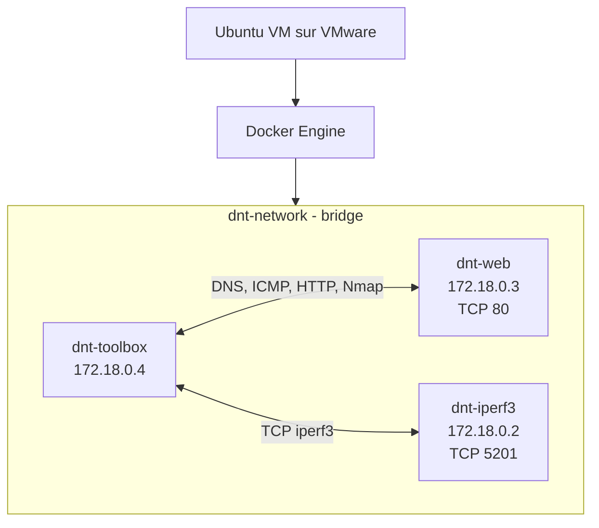

<div align="center">

# Docker Network Toolkit
## Rapport de validation réseau


**Validation fonctionnelle de l'infrastructure Docker Compose**

Projet pédagogique ETML — Infrastructure et réseau

</div>

---

## 1. Objectif

Ce document présente les tests réalisés sur l'infrastructure Docker Network Toolkit le 18 novembre 2026.

L'objectif est de vérifier le fonctionnement des services conteneurisés, leur connectivité réseau et les outils de diagnostic.

Les vérifications portent sur :

1. La résolution DNS entre les conteneurs.
2. La connectivité ICMP.
3. Le fonctionnement du serveur HTTP.
4. L'accessibilité du port TCP 80 avec Nmap.
5. La mesure du débit TCP avec iperf3.

Ces tests ont été réalisés sur les conteneurs du laboratoire.

## 2. Environnement technique

| Élément | Configuration |
|---|---|
| Système hôte | Windows |
| Hyperviseur | VMware |
| Système invité | Ubuntu Linux |
| Conteneurisation | Docker Engine |
| Orchestration | Docker Compose |
| Réseau Docker | `dnt-network` |
| Driver réseau | `bridge` |
| Image Toolbox | Ubuntu 24.04 |
| Image serveur iperf3 | Debian Trixie Slim |
| Serveur web | Nginx Alpine |
| Date des tests | 18 novembre 2026 |

Le laboratoire utilise trois services définis dans le fichier `compose.yaml`.

## 3. Architecture réseau



Les adresses IP sont celles observées pendant la campagne de tests.

Elles sont attribuées dynamiquement par Docker et peuvent changer.

### Services

| Conteneur | Fonction | État constaté |
|---|---|---|
| `dnt-toolbox` | Diagnostic réseau | Running |
| `dnt-web` | Serveur HTTP | Running |
| `dnt-iperf3` | Serveur iperf3 | Running |

Les trois conteneurs étaient actifs lors de l'exécution de la suite de tests.

## 4. Méthodologie

Les tests ont été réalisés depuis la Toolbox, en utilisant les noms DNS des services Docker Compose.

Script utilisé :

`scripts/test-stack.sh`

Commande exécutée à la racine du dépôt :

```bash
bash scripts/test-stack.sh
```

Le script utilise `docker compose exec -T toolbox` pour exécuter les commandes dans la Toolbox.

L'option `-T` désactive l'allocation d'un terminal interactif.

Le script utilise également :

```bash
set -euo pipefail
```

Cette configuration permet notamment d'interrompre l'exécution en cas d'erreur de commande non gérée.

## 5. Test de résolution DNS

### Objectif

Vérifier que les conteneurs communiquent en utilisant leurs noms de services.

### Commandes

```bash
getent hosts web
getent hosts iperf3-server
```

### Résultat observé

```text
172.18.0.3      web
172.18.0.2      iperf3-server
```

### Analyse

Le service `web` est correctement résolu vers `172.18.0.3`.

Le service `iperf3-server` est correctement résolu vers `172.18.0.2`.

Cela confirme le fonctionnement de la résolution DNS utilisée par les conteneurs sur leur réseau Docker personnalisé.

**Résultat : VALIDÉ**

## 6. Test de connectivité ICMP

### Objectif

Vérifier la connectivité entre la Toolbox et le serveur Nginx.

### Commande

```bash
ping -c 3 web
```

### Résultat observé

```text
3 packets transmitted, 3 received
0% packet loss

rtt min/avg/max/mdev =
0.256/0.407/0.533/0.114 ms
```

### Analyse

Les trois paquets ont été transmis et reçus correctement.

Aucune perte de paquets n'a été observée.

| Indicateur | Valeur |
|---|---|
| Paquets envoyés | 3 |
| Paquets reçus | 3 |
| Perte | 0 % |
| RTT minimum | 0.256 ms |
| RTT moyen | 0.407 ms |
| RTT maximum | 0.533 ms |
| Écart mesuré (mdev) | 0.114 ms |

Le résultat confirme une connectivité ICMP fonctionnelle au moment du test.

**Résultat : VALIDÉ**

## 7. Test HTTP

### Objectif

Vérifier que le serveur Nginx répond aux requêtes HTTP depuis un autre conteneur.

### Commande

```bash
curl -fsS http://web/
```

### Résultat observé

```html
<!DOCTYPE html>
<html lang="fr">
<head>
    <meta charset="UTF-8">
    <meta name="viewport"
          content="width=device-width, initial-scale=1.0">
    <title>Docker Network Toolkit</title>
</head>
<body>
    <h1>Docker Network Toolkit</h1>
    <p>Le serveur web fonctionne correctement.</p>
    <p>Service : web</p>
    <p>Infrastructure : Docker Compose</p>
</body>
</html>
```

### Analyse

La commande a récupéré correctement la page HTML servie par Nginx.

Cela confirme :

- La résolution du nom `web`.
- L'accessibilité du service HTTP.
- La réponse du serveur Nginx.
- La disponibilité du contenu web configuré.

**Résultat : VALIDÉ**

## 8. Test Nmap

### Objectif

Identifier l'état du port HTTP du serveur web.

### Commande

```bash
nmap -sT -p 80 web
```

L'option `-sT` utilise un TCP Connect Scan.

L'option `-p 80` limite le scan au port TCP 80.

### Résultat observé

```text
Starting Nmap 7.94SVN

Nmap scan report for web (172.18.0.3)
Host is up (0.00011s latency).

PORT   STATE SERVICE
80/tcp open  http

Nmap done: 1 IP address (1 host up)
scanned in 0.16 seconds
```

### Analyse

Le port TCP 80 est ouvert et accessible depuis la Toolbox.

Ce résultat est cohérent avec le test HTTP effectué précédemment.

Il ne garantit pas que les autres ports sont fermés, puisque seul le port 80 a été testé.

**Résultat : VALIDÉ**

## 9. Test de performance iperf3

### Objectif

Mesurer le débit TCP entre la Toolbox et le serveur iperf3 sur le réseau Docker.

### Commande

```bash
iperf3 -c iperf3-server -t 5
```

Paramètres :

- `-c` : mode client.
- `iperf3-server` : nom DNS du serveur.
- `-t 5` : durée du test de cinq secondes.

### Résultats observés

| Intervalle | Transfert | Débit |
|---|---|---|
| 0–1 s | 1.62 GBytes | 13.9 Gbit/s |
| 1–2 s | 1.06 GBytes | 9.10 Gbit/s |
| 2–3 s | 1.05 GBytes | 9.05 Gbit/s |
| 3–4 s | 1.09 GBytes | 9.36 Gbit/s |
| 4–5 s | 1.10 GBytes | 9.44 Gbit/s |

### Résultat global

```text
Interval: 0.00-5.00 sec

Sender:
Transfer: 5.92 GBytes
Bitrate: 10.2 Gbits/sec
Retransmissions: 0

Receiver:
Transfer: 5.93 GBytes
Bitrate: 10.2 Gbits/sec
```

### Analyse

La connexion TCP entre les deux conteneurs fonctionne correctement.

Le débit moyen mesuré est de 10.2 Gbit/s sur cinq secondes.

Aucune retransmission TCP n'a été relevée par le client pendant la mesure.

Ce débit concerne une communication interne à l'environnement Docker virtualisé.

Il ne représente pas les performances réelles de la connexion Internet ou d'une interface réseau physique.

Ces valeurs constituent une mesure ponctuelle, et non une référence de performance garantie.

**Résultat : VALIDÉ**

## 10. Synthèse des résultats

| Test | Objectif | Résultat |
|---|---|---|
| DNS | Résolution des services | VALIDÉ |
| ICMP | Connectivité réseau | VALIDÉ |
| HTTP | Disponibilité Nginx | VALIDÉ |
| Nmap | Accessibilité TCP 80 | VALIDÉ |
| iperf3 | Communication TCP et débit | VALIDÉ |

**Bilan : 5 catégories de tests validées sur 5.**

Le script s'est terminé avec le message suivant :

```text
Tous les tests ont réussi.
```

## 11. Limites de validation

Cette campagne de tests présente plusieurs limites :

- Les mesures ont été réalisées dans un environnement virtualisé.
- Les performances ont été mesurées sur une durée de cinq secondes.
- Aucun test de charge prolongé n'a été réalisé.
- Aucun audit complet des vulnérabilités n'a été effectué.
- L'isolation entre plusieurs réseaux Docker n'a pas été testée ici.
- Aucun test automatique de reprise après panne n'a été exécuté.
- Les résultats dépendent des ressources disponibles dans la machine virtuelle.

Les résultats sont suffisants pour valider le fonctionnement réseau de base du laboratoire, mais ne constituent pas une validation pour une utilisation en production.

## 12. Améliorations prévues

Les prochaines améliorations techniques concernent :

- L'automatisation des contrôles avec GitHub Actions.
- La validation automatique des Dockerfiles.
- La vérification de la configuration Compose.
- L'analyse de sécurité des images.
- La réduction des privilèges des conteneurs.
- Les tests d'isolation entre réseaux.
- L'ajout de healthchecks.
- La réalisation de nouvelles mesures iperf3.
- La documentation des incidents et procédures de dépannage.

## 13. Conclusion

Les tests effectués le 18 novembre 2026 démontrent que le laboratoire Docker Network Toolkit permet de faire communiquer plusieurs conteneurs sur un réseau Docker personnalisé.

La résolution DNS, la connectivité ICMP, le service HTTP, la détection du port TCP 80 et la communication iperf3 ont été validés.

Cette première campagne fournit une base fonctionnelle pour poursuivre le développement du projet.

---

## Références

- [Docker Networking](https://docs.docker.com/engine/network/)
- [Docker Compose](https://docs.docker.com/compose/)
- [Nmap Documentation](https://nmap.org/book/man.html)
- [iperf3](https://github.com/esnet/iperf)
- [Docker Engine Security](https://docs.docker.com/engine/security/)

---

<div align="center">

**DOCKER NETWORK TOOLKIT**

*Diagnostiquer. Connecter. Isoler. Comprendre.*


[**Retour au README**](../../README.md)

<sub>Rapport de validation — 18 novembre 2026</sub>

</div>
